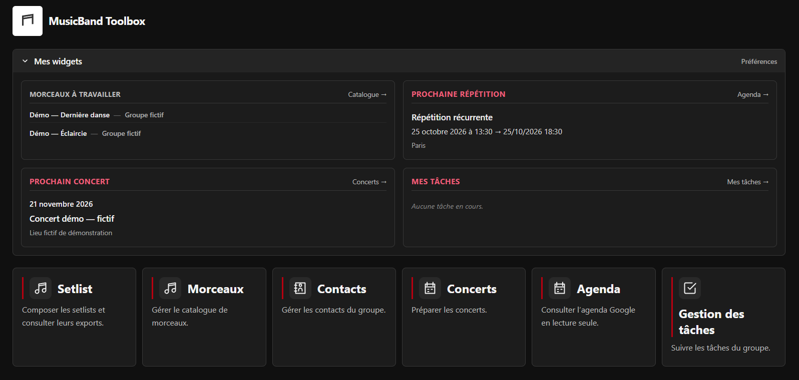

# Musicband Toolbox — Community

Paquet installable sur un hébergement PHP/MySQL pour gérer les morceaux, setlists, contacts, concerts, tâches et notifications d’un groupe.

## Télécharger

Dans le dossier [`package/`](package/), télécharger [`musicband-toolbox-community-2026.10.22.25.zip`](package/musicband-toolbox-community-2026.10.22.25.zip) avec **Download raw file**. L’empreinte figure dans [`SHA256SUMS`](package/SHA256SUMS). Ne pas transférer le dépôt complet sur l’hébergement : extraire le ZIP applicatif ou utiliser le dossier `installation/` décrit ci-dessous.

## Version décompressée

Le dossier [`installation/`](installation/) contient les fichiers exacts du ZIP, dont le code PHP/HTML/JavaScript distribué, les styles, dépendances et règles `.htaccess`. Il permet de consulter le code ou de transférer directement les fichiers sans extraire le paquet. Il ne contient pas les sources ni outils de préparation locaux.

Pour installer depuis cette version, cloner ou télécharger le dépôt, puis transférer **le contenu de `installation/`**, fichiers cachés compris, dans le dossier web choisi. Ne pas transférer le dossier `.git`, `package/` ni le README racine. Suivre ensuite le même parcours `install.php` ou Upgrade ci-dessous. Les fichiers sont copiés sans modification du code ; ils restent soumis à la même validation manuelle que le ZIP.

## Prérequis

- Hébergement HTTPS avec certificat valide pour le domaine utilisé.
- PHP 8.2+ avec PDO MySQL, cURL, mbstring, OpenSSL, fileinfo, session, JSON et zlib.
- MySQL 8.0+ ou MariaDB 10.6+, moteur InnoDB ; utilisateur autorisé à créer et mettre à niveau les tables de cette base.
- Apache 2.4 autorisant les règles `.htaccess` du paquet. Pour un autre serveur, reproduire ces restrictions avant exposition.
- PHP autorisé à créer un dossier privé en dehors de la racine web, avec permissions 0700 ; fichiers privés en 0600.
- Sorties HTTPS autorisées pour Web Push et l’Agenda iCal ; transport e-mail configuré pour les invitations.

## Installer sur un nouvel hébergement

1. Créer une base vide et un utilisateur MySQL dédié. Configurer le domaine et son certificat HTTPS.
2. Extraire le contenu du ZIP, ou transférer le contenu de `installation/`, dans le dossier web choisi, éventuellement en sous-répertoire. Conserver les fichiers cachés `.htaccess`, puis retirer l’archive du dossier public.
3. Ouvrir `https://votre-domaine/chemin/install.php` et renseigner la connexion MySQL, l’URL HTTPS avec barre finale, le nom de l’application et le premier compte administrateur.
4. Terminer l’installation immédiatement après transfert : l’assistant est accessible avant sa finalisation, puis verrouillé. Conserver les informations de reprise en cas d’interruption ; ne pas effacer la base ni le dossier privé.
5. Se connecter et adapter ou retirer les exemples fictifs : cinq morceaux, une setlist, un concert et un contact. Leurs adresses ne doivent pas servir à des envois réels.

Le schéma est initialisé automatiquement, sans import SQL manuel. Les comptes, identifiants MySQL et secrets PWA sont stockés hors racine publique. Aucun modèle, Composer ou serveur applicatif permanent n’est à installer sur l’hébergement.

## Configurer les fonctions

**E-mails et invitations.** Dans Configuration → E-mails, choisir l’expéditeur et le transport, puis effectuer volontairement un test vers une adresse réelle autorisée. Pour SMTP : serveur, port, STARTTLS ou TLS implicite et identifiants du fournisseur. Dans Configuration → Concerts, définir les destinataires calendrier. L’action « Inviter au calendrier… » apparaît sur une fiche enregistrée en consultation si le compte possède le droit d’envoi et si le concert, aujourd’hui ou à venir, comporte adresse, heure d’arrivée, heure de prestation et durée valides. Une seule tentative d’invitation est permise, même en cas d’échec.

**Agenda.** Configuration → Agenda accepte un lien iCal Google privé, sans OAuth. Garder ce lien confidentiel.

**PWA et notifications.** L’installation neuve extrait automatiquement les dépendances Web Push et leurs licences dans le stockage privé, génère les clés VAPID propres à l’instance et prépare la configuration et le lanceur CRON. Aucun secret n’est fourni dans le ZIP. Vérifier le diagnostic de Configuration → Général et les autorisations des comptes et règles souhaités. Chaque utilisateur active volontairement son appareil dans Préférences → Notifications et rappels. Sur iPhone/iPad, ouvrir l’application ajoutée à l’écran d’accueil. Le navigateur exige un certificat HTTPS reconnu ; contourner une alerte de certificat ne valide pas la PWA.

Pour les rappels sans visite du site, créer dans le panneau de l’hébergeur une tâche PHP 8.2+ horaire vers le lanceur privé indiqué dans Upgrade. Ne placer aucun secret dans la commande. Le paquet ne peut pas configurer le panneau de l’hébergeur ni accepter les notifications à la place de l’utilisateur. Vérifier ensuite la dernière exécution dans Configuration → Général.

## Mettre à jour un site existant

Sauvegarder la base, les fichiers publics et le dossier privé avant transfert. Transférer le paquet complet, sans relancer `install.php`. Pour une PWA non configurée, utiliser **Upgrade → Configurer la PWA** : cette action est distincte des migrations SQL et conserve toute configuration et clé existante.

